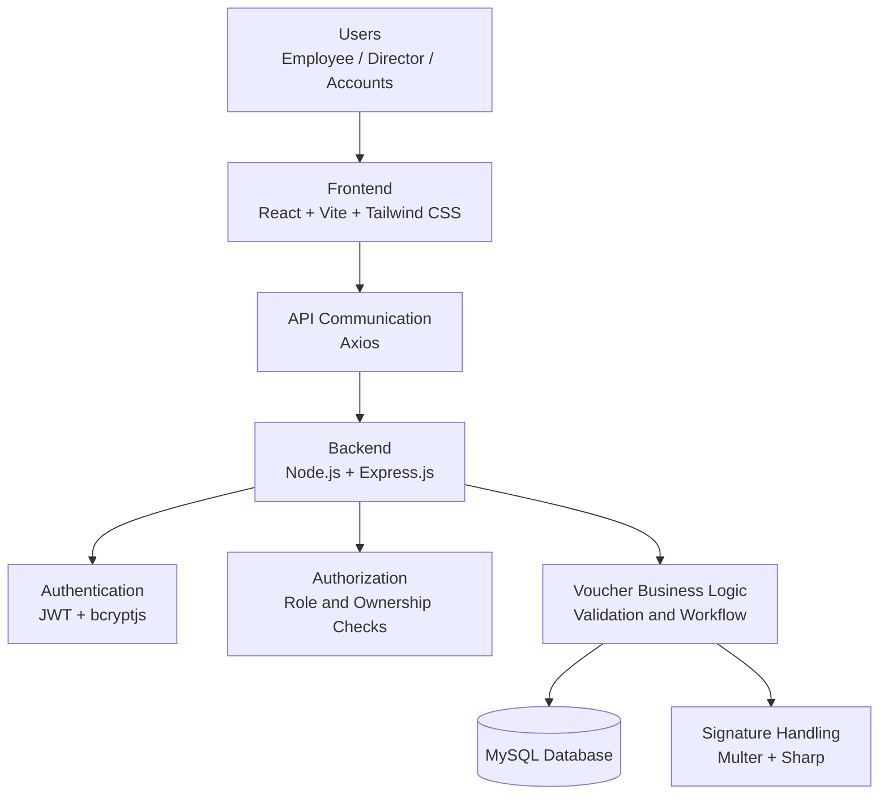
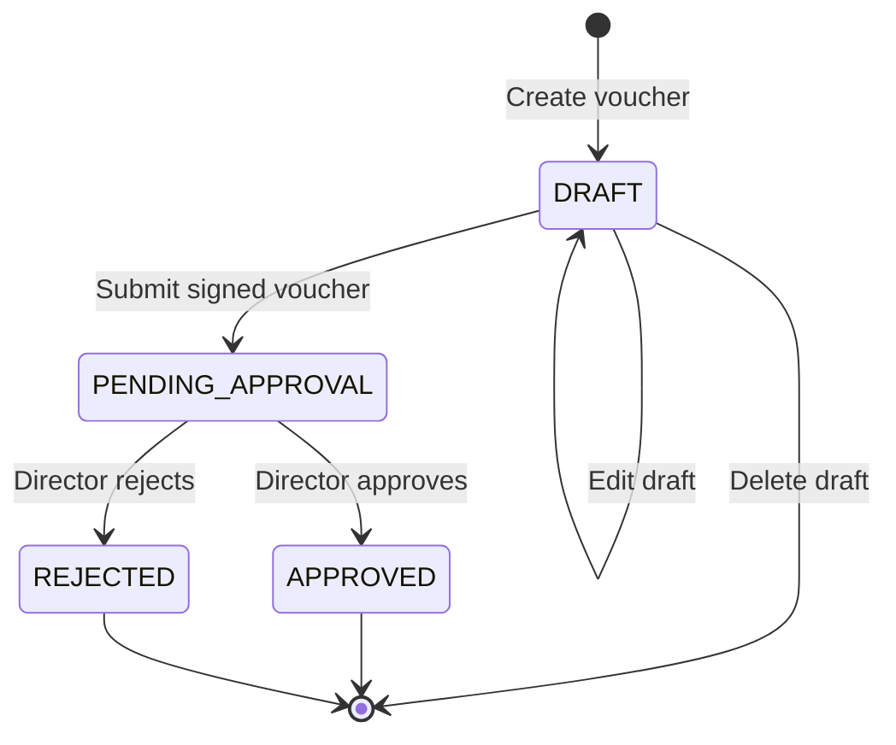
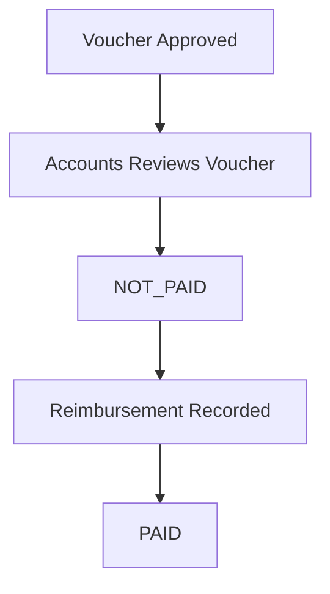
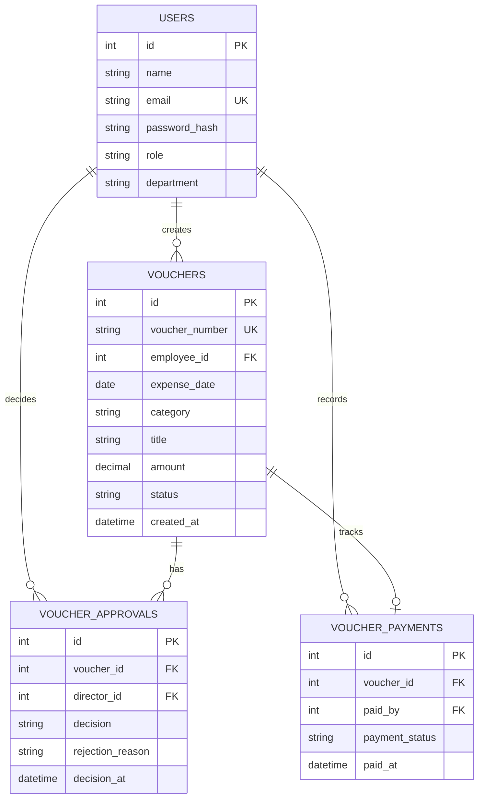
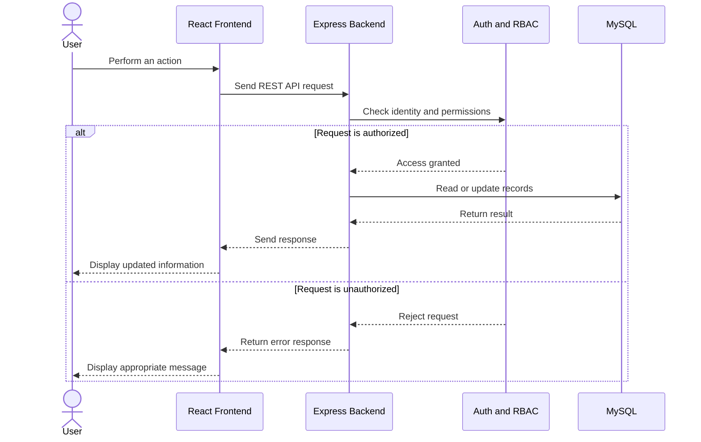

<<<<<<< HEAD
# Expensio — Expense Voucher Management System


**Submitted by:** Tanuja Prasad | MCA, MIT World Peace University

## 1. Project Overview

I developed Expensio, a web-based Expense Voucher Management System, to digitize employee expense claims from draft creation through Director approval and Accounts reimbursement tracking. The application centralizes voucher records, reduces manual follow-up, and provides role-specific access.

## 2. Technology Stack

Frontend: React, Vite, Tailwind CSS, React Router, Axios.  
Backend: Node.js, Express.js, REST APIs.  
Database: MySQL using mysql2 and parameterized SQL queries.  
Authentication and security: JWT, bcryptjs, protected routes, backend role authorization.  
Signature uploads: Multer and Sharp; images are delivered through authenticated endpoints.

## 3. User Roles and Functionalities

Employee: Logs in; creates, edits, or deletes personal draft vouchers; uploads or reuses a signature; submits signed vouchers; views only personal claims and rejection reasons.  
Director: Reviews submitted vouchers, searches and filters records, approves with a signature or rejects with a reason, and views approval dashboard statistics.  
Accounts: Views organization-wide submitted vouchers, approval decisions, signatures, and dashboard statistics; filters records and tracks reimbursements. An additional Accounts-only extension records Approved vouchers as Not Paid or Paid.

### Demo Login

This details are just to access the project and trial purpose 

Employee 
email : employee@gmail.com
password : emp@123

Director
email : director@gmail.com
password : dir@123

Accounts : accounts@gmail.com
Password: acc@123

## 4. Voucher and Reimbursement Workflow

DRAFT → PENDING_APPROVAL → APPROVED or REJECTED.  
A submitted voucher is represented by PENDING_APPROVAL. Rejected vouchers display the Director's reason. Approved vouchers are read-only as expense claims.  
Additional payment tracking: APPROVED + NOT_PAID → APPROVED + PAID (reimbursement recorded). Payment state is stored separately from approval status; marking Paid does not transfer money.

## 5. Dashboards

Employee: Total vouchers, drafts, pending, approved, rejected, and total amount claimed, limited to the signed-in employee.  
Director: Pending approvals, decisions, pending amount, and recent activity.  
Accounts: Total submitted vouchers, pending approval, approved, rejected, total approved expense amount, and recent approved vouchers. Payment extension adds to-process, reimbursement-done, and reimbursed-amount figures.

## 6. Database Design

users — account details, unique email, password hash, role, department, and optional profile signature.  
vouchers — unique generated voucher number, employee foreign key, dates, department, category, title, description, positive amount, employee signature, status, and timestamps.  
voucher_approvals — voucher/director references, approval or rejection decision, Director signature or rejection reason, and decision timestamp.  
voucher_payments (optional extension migration) — one row per voucher, PAID/NOT_PAID status, paid-by user, and payment timestamps.  
Core schema: backend/database/schema.sql. Extension migration: backend/database/accounts_payment_migration.sql (from the separate Accounts Payment Extension patch; confirm it is merged into your final repository).

## 7. Project Setup

Prerequisites: Node.js 20+, npm, MySQL 8+.  
1. Clone the GitHub repository.  
2. Create the database using backend/database/schema.sql for a fresh installation; do not re-run CREATE DATABASE on an existing database.  
3. Copy backend/.env.example to backend/.env and configure DB_HOST, DB_USER, DB_PASSWORD, DB_NAME, JWT_SECRET, PORT, and CLIENT_URL.  
4. If using reimbursement tracking, merge the Accounts Payment Extension into the final project, then execute backend/database/accounts_payment_migration.sql once.  
5. In backend/: npm install; optionally run node scripts/seedUsers.js for local demo users; then npm run dev.  
6. In frontend/: npm install; set VITE_API_BASE_URL to http://localhost:5000/api (or the configured backend port); then npm run dev.  
7. Visit http://localhost:5173 and sign in with a locally configured account for each role.  
Never commit .env, database passwords, real JWT secrets, or production credentials.

## 8. API Documentation

POST /api/auth/login — public authentication.  
GET /api/auth/me — authenticated user.  
GET /api/vouchers/my and /api/vouchers/my/stats — Employee-only vouchers and metrics.  
POST /api/vouchers — create draft; PUT/DELETE /api/vouchers/:id — edit/delete own draft.  
POST /api/vouchers/:id/signature — upload employee signature; POST /api/vouchers/:id/submit — submit signed draft.  
GET /api/review, /api/review/stats, /api/review/:id — Director/Accounts read access.  
GET /api/review/:id/signature/:kind — authenticated signature view.  
POST /api/review/:id/approve and /api/review/:id/reject — Director only.  
GET /api/accounts/dashboard — Accounts dashboard.  
GET /api/accounts/payments — Accounts payment queue.  
PATCH /api/accounts/payments/:id — Accounts-only payment status update (PAID or NOT_PAID).  
Authenticated routes require Authorization: Bearer <JWT>. Signature upload uses multipart/form-data.

## 9. Validation and Authorization

Required: department, title, expense date, amount greater than zero, employee signature before submission, Director signature for approval, and a rejection reason for rejection.  
Only employees may change their own DRAFT vouchers. Submitted claims are read-only for employees. Only Directors approve/reject. Only Accounts can update reimbursement status, and only on approved vouchers. Backend role and ownership checks are essential; hiding frontend buttons is not sufficient.

## 10. Assumptions and Design Decisions

1. 'Submitted' and 'Pending Approval' are represented by one stored state: PENDING_APPROVAL.  
2. Drafts are private to employees; Director and Accounts organization-wide views focus on submitted vouchers. This is an implementation assumption despite the assignment's broad 'all vouchers' wording.  
3. Voucher numbers are generated automatically and uniquely.  
4. Accounts payment marking is an additional feature beyond the required read-only voucher workflow; it updates reimbursement metadata, not voucher details or Director decisions.  
5. Payment marking records completion of reimbursement outside the application; it does not initiate bank transfers.  
6. The payment extension stores current payment status, not a complete immutable payment history.
7.Assumed 3 users with different passwords.

## 11. Repository Structure

backend/src/controllers — request handlers and business logic.  
backend/src/routes — role-protected REST endpoints.  
backend/src/middleware — authentication, authorization, upload validation.  
backend/src/services — voucher data operations.  
backend/database — schema and migration SQL.  
frontend/src/pages — role-based dashboards, voucher forms, and details.  
frontend/src/api — authenticated Axios services.  
frontend/src/context and components — session state, shared UI, and protected routes.


## 12. Conclusion

Expensio demonstrates full-stack application development through role-based workflows, secure authentication, relational database design, REST APIs, signature uploads, validation, and dashboard reporting. The Accounts reimbursement extension demonstrates how the system can support operational follow-up after Director approval.
=======
# Expensio – Expense Voucher Management System

**GitHub Repository:** [Expensio – Expense Voucher Management System](https://github.com/tanuja-prasad/Expensio-Expense-Voucher-Management-System)

**Submitted by:** Tanuja Prasad  
**Course:** MCA  
**College:** MIT World Peace University, Pune

---

## 1. Project Overview

I developed **Expensio**, a web-based Expense Voucher Management System, to make the process of managing employee expense claims easier and more organized.

In a manual expense management process, employees may need to maintain records, submit expense claims, follow up for approvals, and check whether their reimbursement has been completed. Managing these activities manually can make it difficult to track the status of claims and maintain proper records.

To solve this problem, I developed Expensio, where employees can create and submit expense vouchers, Directors can approve or reject them, and the Accounts department can review approved vouchers and track reimbursement status.

The application has separate dashboards for Employees, Directors, and Accounts users. Each role has different permissions, and access to the application's features is controlled through backend authorization.

The main objective of this project was to understand how a real-world business workflow can be converted into a full-stack web application.

## 2. Objectives

The main objectives of Expensio are:

- To digitize the employee expense voucher process.
- To allow employees to create, edit, and submit expense claims.
- To implement a proper approval workflow for Directors.
- To maintain approval decisions and rejection reasons.
- To provide role-based dashboards and access control.
- To store voucher and user information in a relational database.
- To allow Accounts users to review submitted vouchers and track reimbursements.
- To reduce manual follow-ups and make expense records easier to manage.

## 3. Technology Stack

I used the following technologies to develop this project.

| Component | Technology |
|---|---|
| Frontend | React.js, Vite |
| Styling | Tailwind CSS |
| Routing | React Router |
| API Requests | Axios |
| Backend | Node.js, Express.js |
| Database | MySQL |
| Database Connectivity | mysql2 |
| Authentication | JSON Web Token (JWT) |
| Password Hashing | bcryptjs |
| File Uploads | Multer |
| Image Processing | Sharp |
| Version Control | Git and GitHub |

## 4. System Architecture

I followed a client-server architecture in which the frontend communicates with the backend through REST APIs. The backend handles authentication, authorization, voucher operations, and database interactions.

The MySQL database stores the application's user information, expense vouchers, and approval records. Signature uploads are handled separately through the backend.

### Architecture Diagram



### How the System Works

1. The user logs in through the React frontend.
2. The frontend sends the login request to the Express backend.
3. The backend verifies the user's credentials and provides the configured authentication token.
4. When the user performs an operation, the backend checks authentication, role permissions, and ownership where required.
5. The backend processes the request and interacts with MySQL or the signature-handling logic.
6. The response is returned to the frontend, which updates the relevant page or dashboard.

This separation helps keep the user interface, business logic, and database operations organized.

## 5. User Roles and Functionalities

I implemented three main roles in the application.

### 5.1 Employee

Employees can:

- Log in to their accounts.
- Create expense vouchers in draft status.
- Edit or delete their own draft vouchers.
- Enter the expense date, department, category, title, description, and amount.
- Upload or reuse their signature.
- Submit signed vouchers for approval.
- View their own expense vouchers and current status.
- View the reason when a voucher is rejected.
- Check dashboard statistics such as total vouchers, pending claims, approved claims, rejected claims, and total claimed amount.

Once an employee submits a voucher, it becomes read-only for that employee.

### 5.2 Director

The Director is responsible for reviewing expense claims and making approval decisions.

The Director can:

- View submitted vouchers awaiting approval.
- Search and filter voucher records.
- Review voucher details and employee signatures.
- Approve vouchers with a Director signature.
- Reject vouchers by providing a reason.
- View pending approvals and approval-related statistics.
- Track recent approval activity.

Only the Director role is allowed to approve or reject vouchers.

### 5.3 Accounts

The Accounts department is responsible for reviewing vouchers and tracking reimbursement progress.

Accounts users can:

- View organization-wide submitted vouchers.
- Review voucher details and approval decisions.
- View employee and Director signatures.
- Search and filter voucher records.
- View dashboard statistics and approved expense amounts.
- Track approved vouchers that require reimbursement.

I also designed an additional payment-tracking feature through which Accounts users can mark approved vouchers as `NOT_PAID` or `PAID`.

This feature records the reimbursement status in the application. It does not initiate an actual bank transfer.

## 6. Voucher Workflow and System Design

The voucher workflow is one of the main parts of Expensio. I designed it so that a voucher moves through specific states instead of allowing users to change its status arbitrarily.

### Voucher Lifecycle Diagram



### Workflow Explanation

**1. Draft Creation**

The employee creates a voucher and enters the required expense information. The voucher remains in `DRAFT` status.

**2. Draft Editing**

The employee can edit or delete the voucher while it is still a draft.

**3. Submission**

After entering the required information and attaching a signature, the employee submits the voucher. Its status changes to `PENDING_APPROVAL`.

**4. Director Review**

The Director reviews the submitted voucher and decides whether to approve or reject it.

**5. Approval or Rejection**

- If approved, the voucher status becomes `APPROVED`.
- If rejected, the status becomes `REJECTED`, and the rejection reason is stored.

Approved and rejected vouchers are treated as finalized expense claims in the core workflow.

### Additional Reimbursement Workflow

The Accounts payment-tracking extension maintains payment status separately from approval status.



This separation helps distinguish the Director's approval decision from the subsequent reimbursement process.

The payment-tracking flow applies only when the optional extension is integrated into the final project.

## 7. Database Design

I used MySQL to store the application's data and maintain relationships between users, vouchers, and approval records.

### Database Tables

| Table | Description |
|---|---|
| `users` | Stores user information, email, password hash, role, department, and optional profile signature. |
| `vouchers` | Stores voucher number, employee reference, expense details, amount, signature, status, and timestamps. |
| `voucher_approvals` | Stores approval or rejection decisions, Director reference, signature or rejection reason, and decision timestamp. |
| `voucher_payments` | Optional table for reimbursement status, Accounts user reference, and payment timestamps. |

### Entity Relationship Diagram

The following diagram represents the intended relationships between the core tables.



*Note: This is a logical representation of the database design. The optional payment table and exact columns or relationship cardinalities should be checked against the actual SQL schema and migration.*

### Database Design Considerations

- Each voucher has a unique voucher number.
- Each voucher is associated with the employee who created it.
- Approval records maintain the Director's decision and related information.
- Expense amounts must be greater than zero.
- Payment status is separate from approval status.
- Parameterized SQL queries are used to reduce SQL injection risks.
- Foreign keys and other database constraints should maintain data consistency where defined in the schema.

The core schema is available at `backend/database/schema.sql`.

The optional reimbursement migration is `backend/database/accounts_payment_migration.sql`, if included in the final repository.

## 8. API Design

I used REST APIs to connect the frontend with the backend. The APIs are grouped according to authentication, employee voucher operations, approval operations, and Accounts functionality.

The following endpoints are based on the documented implementation.

### Authentication APIs

| Method | Endpoint | Purpose |
|---|---|---|
| POST | `/api/auth/login` | Authenticate a user |
| GET | `/api/auth/me` | Retrieve the current user's information |

### Employee APIs

| Method | Endpoint | Purpose |
|---|---|---|
| GET | `/api/vouchers/my` | Retrieve personal vouchers |
| GET | `/api/vouchers/my/stats` | Retrieve employee dashboard statistics |
| POST | `/api/vouchers` | Create a draft voucher |
| PUT | `/api/vouchers/:id` | Update an owned draft |
| DELETE | `/api/vouchers/:id` | Delete an owned draft |
| POST | `/api/vouchers/:id/signature` | Upload an employee signature |
| POST | `/api/vouchers/:id/submit` | Submit a signed voucher |

### Director and Accounts APIs

| Method | Endpoint | Purpose |
|---|---|---|
| GET | `/api/review` | View submitted vouchers |
| GET | `/api/review/stats` | Retrieve review statistics |
| GET | `/api/review/:id` | Retrieve voucher details |
| GET | `/api/review/:id/signature/:kind` | Retrieve an authorized signature |
| POST | `/api/review/:id/approve` | Approve a voucher |
| POST | `/api/review/:id/reject` | Reject a voucher |
| GET | `/api/accounts/dashboard` | Retrieve Accounts dashboard statistics |

### Optional Payment APIs

| Method | Endpoint | Purpose |
|---|---|---|
| GET | `/api/accounts/payments` | Retrieve reimbursement records |
| PATCH | `/api/accounts/payments/:id` | Update payment status |

The payment endpoints require the Accounts extension to be present in the backend.

### API Request Flow



## 9. Authentication and Authorization

I used JWT-based authentication and bcryptjs for password hashing.

The backend is responsible for checking whether a user is authenticated and whether that user is allowed to perform a particular operation.

For example:

- An employee can modify only their own draft vouchers.
- An employee cannot approve or reject a voucher.
- A Director can approve or reject submitted vouchers.
- Accounts users can review organization-wide submitted vouchers.
- Only authorized Accounts users can update reimbursement status when the extension is enabled.

Protected routes on the frontend help control navigation, but the backend must enforce the actual permissions.

### Security and Validation Rules

The application requires the following validations:

- Department, title, expense date, and a valid positive amount.
- Employee signature before submission.
- Director signature before approval.
- A rejection reason when rejecting a voucher.
- Ownership checks for employee-specific operations.
- Role checks for approval and reimbursement operations.
- Restrictions on editing vouchers after submission.

I also used parameterized SQL queries for database operations and Multer with Sharp for signature upload and image processing.

The precise token-storage approach, token expiry, upload validation rules, and production security settings should be verified against the final source code before deployment.

## 10. Dashboard Design

I created separate dashboards so that each user can view information relevant to their role.

| Dashboard | Main Information |
|---|---|
| Employee | Total vouchers, drafts, pending claims, approved claims, rejected claims, and total amount claimed |
| Director | Pending approvals, approval decisions, pending amount, and recent activity |
| Accounts | Submitted vouchers, approval status distribution, approved expense amount, and recent approved vouchers |
| Accounts payment extension | Vouchers awaiting reimbursement, completed reimbursements, and reimbursed amount |

The purpose of these dashboards is to make the current state of the expense workflow easier to understand without manually checking individual records.

## 11. Project Structure

The documented project structure is organized into frontend and backend modules.

```text
Expensio-Expense-Voucher-Management-System/
│
├── backend/
│   ├── database/
│   │   ├── schema.sql
│   │   └── accounts_payment_migration.sql
│   │
│   ├── src/
│   │   ├── controllers/
│   │   ├── routes/
│   │   ├── middleware/
│   │   └── services/
│   │
│   ├── scripts/
│   │   └── seedUsers.js
│   │
│   ├── .env.example
│   └── package.json
│
├── frontend/
│   ├── src/
│   │   ├── pages/
│   │   ├── api/
│   │   ├── context/
│   │   └── components/
│   │
│   └── package.json
│
└── README.md
```

The backend contains the API routes, controllers, middleware, and database-related files. The frontend contains the pages, shared components, API services, and session-related code.

The exact file structure may vary slightly depending on the latest repository changes.

## 12. How to Run the Project Locally

### Prerequisites

- Node.js 20 or a compatible version supported by the project.
- npm.
- MySQL 8 or a compatible MySQL server.
- Git.

### Step 1: Clone the Repository

```bash
git clone https://github.com/tanuja-prasad/Expensio-Expense-Voucher-Management-System.git

cd Expensio-Expense-Voucher-Management-System
```

### Step 2: Set Up the Database

Open your MySQL client and execute the core schema:

```sql
SOURCE backend/database/schema.sql;
```

Make sure you are connected to the correct MySQL server and that the schema file is accessible from your current working directory.

If the database already exists, check the schema before rerunning database-creation statements.

### Step 3: Configure and Run the Backend

```bash
cd backend
npm install
```

Copy `.env.example` to `.env` and configure the database credentials, JWT secret, port, and frontend URL.

Example configuration:

```env
DB_HOST=localhost
DB_USER=your_mysql_user
DB_PASSWORD=your_mysql_password
DB_NAME=your_database_name
JWT_SECRET=your_strong_random_secret
PORT=5000
CLIENT_URL=http://localhost:5173
```

Use the exact variable names required by the actual backend configuration.

Start the backend using the script available in `backend/package.json`:

```bash
npm run dev
```

### Step 4: Configure and Run the Frontend

Open a separate terminal:

```bash
cd frontend
npm install
```

If the frontend uses the `VITE_API_BASE_URL` environment variable, configure it in `frontend/.env`:

```env
VITE_API_BASE_URL=http://localhost:5000/api
```

Start the frontend:

```bash
npm run dev
```

### Step 5: Open the Application

Open the local frontend URL:

`http://localhost:5173`

Log in using an account configured for the required role.

For a complete demonstration, prepare separate Employee, Director, and Accounts accounts. The availability of demo users depends on the seed script and the current database setup.

### Optional: Enable Reimbursement Tracking

If the payment extension has been merged:

1. Verify the migration against the core schema.
2. Execute `backend/database/accounts_payment_migration.sql` once.
3. Confirm the payment routes are registered.
4. Test the Accounts-only authorization rules.
5. Verify that reimbursement updates do not change the Director's approval decision.

Never commit `.env` files, actual passwords, or production secrets to GitHub.

## 13. Challenges and Learning Outcomes

While developing Expensio, I worked on connecting the frontend, backend, and database into a single application.

Some of the important concepts I explored through this project were:

- Designing a relational database for users, vouchers, and approvals.
- Connecting React components to Express REST APIs.
- Managing authentication and protected routes.
- Implementing different permissions for different user roles.
- Handling file uploads for employee and Director signatures.
- Validating expense information before allowing submission.
- Managing voucher status transitions.
- Separating the approval workflow from reimbursement tracking.
- Organizing backend code into routes, controllers, middleware, and services.
- Using Git and GitHub to maintain the project.

This project helped me understand how full-stack development involves more than building individual pages. The frontend, backend, database, authorization rules, and workflow must work together correctly.

## 14. Future Enhancements

Some improvements I would like to explore in future versions are:

- Email notifications for submission, approval, and rejection.
- Receipt and invoice uploads.
- Exporting voucher reports to PDF or Excel.
- A complete reimbursement history.
- More advanced expense analytics.
- Automated testing for APIs and user workflows.
- Deployment with HTTPS and managed database hosting.
- Improved reporting and filtering for larger datasets.

These are possible future enhancements and are not intended to indicate that they are already implemented.

## 15. Conclusion

Through Expensio, I developed a full-stack application for managing employee expense vouchers, Director approvals, and Accounts review.

The project combines React, Node.js, Express.js, and MySQL with authentication, role-based authorization, REST APIs, database operations, and signature handling.

Working on this application helped me understand how to design and implement a business workflow using different components of a web application. It also gave me practical experience in organizing code, managing data, validating user actions, and maintaining separate permissions for different roles.

---

## Author

**Tanuja Prasad**  
MCA Student, MIT World Peace University, Pune

- GitHub Profile: [tanuja-prasad](https://github.com/tanuja-prasad)
- Project Repository: [Expensio – Expense Voucher Management System](https://github.com/tanuja-prasad/Expensio-Expense-Voucher-Management-System)
>>>>>>> 6e4a5a4353d2d392c137d0d32455bf66d8e775d5

